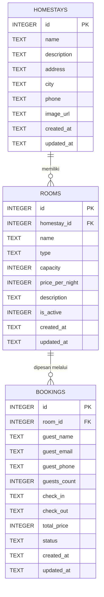

# ERD Mulakjabu

Diagram di bawah memakai sintaks Mermaid. GitHub akan merendernya otomatis; untuk dokumen proyek,
buka https://mermaid.live, tempel kode diagram, lalu ekspor sebagai PNG atau SVG.

## Relasi

| Relasi | Kardinalitas | Aturan hapus | Alasan |
|---|---|---|---|
| homestays -> rooms | 1 : N | `ON DELETE CASCADE` | Kamar tidak berarti tanpa homestay-nya, jadi ikut terhapus. |
| rooms -> bookings | 1 : N | `ON DELETE RESTRICT` | Riwayat pesanan harus tetap ada, jadi kamar yang punya pesanan tidak boleh dihapus. |

## Kamus Data

### homestays
| Kolom | Tipe | Constraint | Keterangan |
|---|---|---|---|
| id | INTEGER | PK, AUTOINCREMENT | Identitas homestay |
| name | TEXT | NOT NULL, minimal 3 karakter | Nama homestay |
| description | TEXT | - | Deskripsi singkat |
| address | TEXT | NOT NULL | Alamat lengkap |
| city | TEXT | NOT NULL, di-index | Kota/daerah, dipakai untuk filter |
| phone | TEXT | - | Nomor kontak |
| image_url | TEXT | - | URL foto |
| created_at, updated_at | TEXT | NOT NULL, default `datetime('now')` | Waktu dibuat dan diubah (UTC) |

### rooms
| Kolom | Tipe | Constraint | Keterangan |
|---|---|---|---|
| id | INTEGER | PK, AUTOINCREMENT | Identitas kamar |
| homestay_id | INTEGER | FK -> homestays.id, NOT NULL, CASCADE | Pemilik kamar |
| name | TEXT | NOT NULL, minimal 2 karakter | Nama kamar |
| type | TEXT | NOT NULL | Jenis kamar (standard, family, suite, dll.) |
| capacity | INTEGER | NOT NULL, > 0 | Jumlah tamu maksimum |
| price_per_night | INTEGER | NOT NULL, >= 0 | Harga per malam dalam Rupiah |
| description | TEXT | - | Deskripsi fasilitas |
| is_active | INTEGER | NOT NULL, 0 atau 1, default 1 | Kamar tersedia untuk dipesan atau tidak |
| created_at, updated_at | TEXT | NOT NULL | Waktu dibuat dan diubah |

### bookings
| Kolom | Tipe | Constraint | Keterangan |
|---|---|---|---|
| id | INTEGER | PK, AUTOINCREMENT | Identitas pesanan |
| room_id | INTEGER | FK -> rooms.id, NOT NULL, RESTRICT | Kamar yang dipesan |
| guest_name | TEXT | NOT NULL, minimal 2 karakter | Nama tamu |
| guest_email | TEXT | NOT NULL | Email tamu (format divalidasi di API) |
| guest_phone | TEXT | - | Nomor telepon tamu |
| guests_count | INTEGER | NOT NULL, > 0 | Jumlah tamu (tidak boleh melebihi kapasitas, divalidasi di API) |
| check_in, check_out | TEXT | NOT NULL, `check_out > check_in` | Tanggal ISO `YYYY-MM-DD` |
| total_price | INTEGER | NOT NULL, >= 0 | Malam x harga per malam, dihitung server |
| status | TEXT | NOT NULL, default `pending` | `pending`, `confirmed`, `cancelled`, `completed` |
| created_at, updated_at | TEXT | NOT NULL | Waktu dibuat dan diubah |

## Aturan yang Ditegakkan di Lapisan Mana

| Aturan | Database (Tahap 1) | API (Tahap 2) |
|---|---|---|
| Foreign key valid, kapasitas > 0, harga >= 0, status valid, `check_out > check_in` | Ya (CHECK dan FK) | Ya (pesan error ramah lewat Zod) |
| Format email, jumlah tamu <= kapasitas kamar | Tidak | Ya |
| Tanggal pesanan tidak bentrok pada kamar yang sama | Tidak (butuh query lintas baris) | Ya (cek sebelum insert) |
